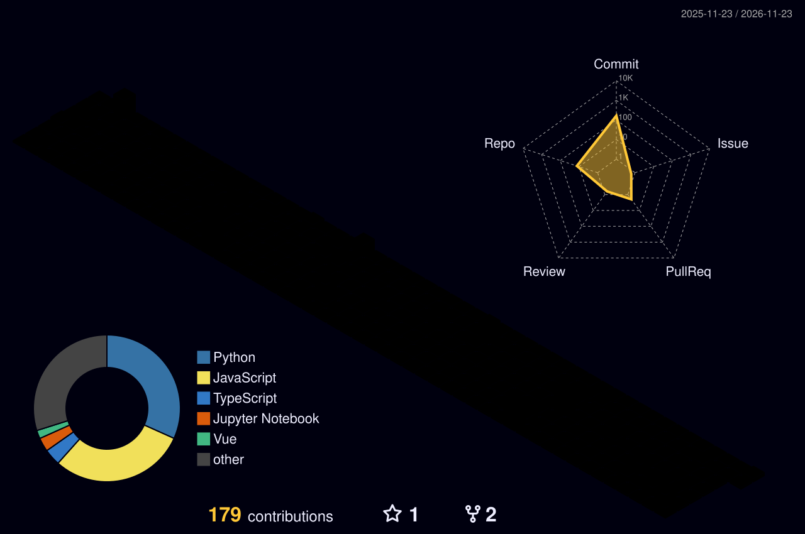

<!--
  Frank Jáuregui — GitHub Profile README
  Theme: GitHub dark + purple + cyan
  Palette: #0d1117 · #a78bfa · #06b6d4
-->

<div align="center">
  
</div>

<div align="center">
  
</div>

<br/>

<div align="center">
  <a href="https://linkedin.com/in/frank-jauregui">
    
  </a>
  &nbsp;
  <a href="mailto:frankjaureguibendezu81@gmail.com">
    
  </a>
  &nbsp;
  <a href="https://github.com/FRANKEVIN25">
    
  </a>
  &nbsp;
  
</div>

<br/>

## 👨‍💻 About me

I'm a **Computer Engineering student at Universidad Peruana Cayetano Heredia (UPCH)** and a **Full Stack Developer from Peru 🇵🇪**.

I build software that moves beyond demos: **business platforms, production CRM systems, real-time communication tools, IoT + ML pipelines, edge AI, cloud infrastructure and accessible digital products**.

My main stack is **Python / Django + Svelte / React + PostgreSQL**, with experience deploying and operating systems on **AWS, Docker, Linux and Nginx**. I also work across **QA, performance testing, applied AI, computer vision, MQTT/IoT and telephony infrastructure**.

```typescript
const frank = {
  role: "Full Stack Developer",
  location: "Lima, Peru 🇵🇪",
  mainStack: ["Python", "Django", "Svelte", "PostgreSQL", "Redis", "AWS"],
  domains: ["B2B Systems", "Applied AI", "IoT", "Cloud", "QA"],
  currently: "Building independent CRM, automation and AI products",
  openTo: ["Internships", "Junior roles", "Remote collaboration"],
  mindset: "Build → Test → Deploy → Improve 🚀",
};
```

<br/>

## 🧰 Tech stack

### Backend & APIs

     

### Frontend

    

### Data, Cloud & DevOps

      

### AI, ML & IoT

      

### QA, Communications & Infrastructure

     

<br/>

## 🚀 Featured projects

<table>
<tr>
<td width="50%" valign="top">

<h3>💬 CRM GAVI PERÚ</h3>
<p><strong>Production CRM for an automotive parts distributor.</strong></p>
<p>Centralizes customers, opportunities, quotations, tasks and WhatsApp conversations. Includes shared inboxes, automatic conversation distribution, advisor availability, multimedia handling, templates, permissions, auditing and commercial workflows.</p>
<p><strong>Role:</strong> Full Stack Developer · <strong>Status:</strong> Production ✅ · <strong>Repository:</strong> Private</p>

     

</td>
<td width="50%" valign="top">

<h3><a href="https://github.com/FRANKEVIN25/SISTEMA_MONITOREO">🐢 Ñawi Aupi · Wildlife Hatching Monitor</a></h3>
<p><strong>Edge-AI monitoring for sea turtle and Peruvian tern nests.</strong></p>
<p>A Raspberry Pi runs custom YOLO models locally. When hatching is detected, the backend dispatches a WhatsApp alert with an image so conservation volunteers can react in time.</p>
<p><strong>Role:</strong> Developer · <strong>Status:</strong> Functional system ✅</p>

    

</td>
</tr>

<tr>
<td width="50%" valign="top">

<h3><a href="https://github.com/FRANKEVIN25/ecowatt-2026">⚡ EcoWatt 2026</a></h3>
<p><strong>Smart residential energy monitoring with IoT + NILM.</strong></p>
<p>Arduino/ESP32 telemetry is published through MQTT to Django. PyTorch models disaggregate appliance consumption while a SvelteKit dashboard shows real-time measurements, predictions and AI-assisted recommendations.</p>
<p><strong>Role:</strong> Software Lead / Backend · <strong>Status:</strong> Hackathon prototype ✅</p>

    

</td>
<td width="50%" valign="top">

<h3><a href="https://github.com/FRANKEVIN25/HACKATHON_FACI_2026">🤟 MARI · LSP Health Communication</a></h3>
<p><strong>Accessible patient–doctor communication for Peruvian Sign Language contexts.</strong></p>
<p>Two-device clinical flow with consent, secure linking, synchronized questions, private video responses, editable summaries and an interactive Three.js body model. It continues my accessibility work started with the Maky Rimay concept.</p>
<p><strong>Role:</strong> Developer · <strong>Status:</strong> Functional MVP ✅</p>

   

</td>
</tr>

<tr>
<td width="50%" valign="top">

<h3><a href="https://github.com/FRANKEVIN25/AURA">🔮 AURA</a></h3>
<p><strong>Generative habit experience with real-time feedback and AI projections.</strong></p>
<p>A reactive personal-energy interface built with Next.js and Convex. Check-ins update the experience in real time while AI generates a “Two Futures” projection to make long-term consequences tangible.</p>
<p><strong>Role:</strong> Developer · <strong>Status:</strong> Deployed prototype ✅</p>

    

</td>
<td width="50%" valign="top">

<h3><a href="https://github.com/FRANKEVIN25/Hiraoka-Services-Portal-PLM">🧪 Hiraoka Services Portal</a></h3>
<p><strong>Post-sales ticket platform + full QA lifecycle.</strong></p>
<p>Microservices platform with ticket tracking, RBAC, audit logs, notifications and management KPIs. I worked as QA lead across the project lifecycle with API suites, load testing, UAT and Go/No-Go reporting.</p>
<p><strong>Role:</strong> QA Lead · <strong>Status:</strong> Delivered ✅</p>

    

</td>
</tr>
</table>

<br/>

## 🛰️ Production, infrastructure & research work

| Project | What I built / explored | Main technologies | Status |
|---|---|---|---|
| **Central Telefónica IP — GAVI PERÚ** | Business PBX with SIP trunk, IVR/queue routing, extensions, call distribution and operational metrics | FreePBX 17 · Asterisk 22 · Debian 12 · PJSIP · AWS · Fail2Ban | Production ✅ |
| **Kubernetes + Odoo** | Distributed-systems project comparing Odoo replicas, shared PostgreSQL and horizontal scaling under load | Kubernetes · Odoo · PostgreSQL · HPA · Docker · load testing | Academic project |
| **ONI Time-Series Forecasting** | Rebuilt an El Niño forecasting baseline with lag/difference features and cross-validation, reducing RMSE to ~0.131 | Python · pandas · scikit-learn · LightGBM | Completed ✅ |
| **Digital Notebook** | Database-backed digital notebook concept with interactive page-flip UX | Web UI · persistence · interaction design | Prototype |
| **Fog Water Harvesting Study** | Engineering design study comparing location, climate, materials, collection methods and expected water capture | Engineering research · sustainability | Academic work |

<br/>

<details>
<summary><b>📚 View my complete public project catalog</b></summary>

<br/>

| Project | Description | Repository |
|---|---|---|
| **MARI · LSP Health Communication** | Accessible patient–doctor workflow with private video, synchronization and 3D body interaction | [HACKATHON_FACI_2026](https://github.com/FRANKEVIN25/HACKATHON_FACI_2026) |
| **Peru Public Spending Dashboard** | Interactive Streamlit dashboard for public spending data from 2012–2023 | [Dashboard](https://github.com/FRANKEVIN25/Dashboard) |
| **Fundamentos de Diseño — ODS 14** | Design/research project around sustainable solutions and ocean acidification | [7_FDD_PROYECTO](https://github.com/FRANKEVIN25/7_FDD_PROYECTO) |
| **Personal Portfolio** | Bilingual Vue 3 + TypeScript portfolio with Tailwind and i18n | [mi-portafolio](https://github.com/FRANKEVIN25/mi-portafolio) |
| **Mi Balance** | Personal-finance app for movements, budgets, debt, savings goals and accounts | [Mi_Balance](https://github.com/FRANKEVIN25/Mi_Balance) |
| **NurseCalc** | Mobile-first nursing calculator for doses, IV rates, dilutions and unit conversion | [NurseCalc](https://github.com/FRANKEVIN25/NurseCalc) |
| **GAVI Web** | Business web project for GAVI PERÚ | [GAVI-WEB](https://github.com/FRANKEVIN25/GAVI-WEB) |
| **EcoWatt 2026** | IoT + NILM residential energy monitoring platform | [ecowatt-2026](https://github.com/FRANKEVIN25/ecowatt-2026) |
| **DYE Import** | Responsive automotive-parts catalog with WhatsApp sales funnel | [DYE-IMPORT](https://github.com/FRANKEVIN25/DYE-IMPORT) |
| **Wildlife Monitoring — Project Docs** | Engineering documentation and design process behind the hatching-monitor system | [GRUPO_4_PROYECTOS](https://github.com/FRANKEVIN25/GRUPO_4_PROYECTOS) |
| **DentAI** | Chrome MV3 voice assistant prototype for guided clinical form completion | [DentAI](https://github.com/FRANKEVIN25/DentAI) |
| **ImpulsaUPCH** | Responsive frontend for internship preparation, offers, CV, simulator, forum and calendar | [Impulsa_UPCH](https://github.com/FRANKEVIN25/Impulsa_UPCH) |
| **Cazador de Frutas** | Tile-based 2D Python/pygame game using OOP and text-defined maps | [Cazador-de-Frutas](https://github.com/FRANKEVIN25/Cazador-de-Frutas) |
| **Mi Tiendita** | Lightweight mobile-first sales, inventory and finance app backed by Supabase | [App_movile](https://github.com/FRANKEVIN25/App_movile) |
| **AURA** | Real-time generative habit experience using AI + reactive data | [AURA](https://github.com/FRANKEVIN25/AURA) |
| **Ñawi Aupi / Wildlife Hatching Monitor** | YOLO + Raspberry Pi edge detection with WhatsApp alerts | [SISTEMA_MONITOREO](https://github.com/FRANKEVIN25/SISTEMA_MONITOREO) |
| **Hiraoka Services Portal** | Post-sales service platform and QA project | [Hiraoka-Services-Portal-PLM](https://github.com/FRANKEVIN25/Hiraoka-Services-Portal-PLM) |
| **Linux Lab** | Linux practice and learning repository | [Linux](https://github.com/FRANKEVIN25/Linux) |
| **Horario** | Small utility / scheduling repository | [Horario](https://github.com/FRANKEVIN25/Horario) |

</details>

<br/>

## 🧊 3D contribution universe

<div align="center">
  
</div>

<br/>

## 📊 GitHub engineering activity

<div align="center">
  
</div>

<br/>

<div align="center">
  
  &nbsp;
  
</div>

<br/>

<div align="center">
  
  &nbsp;
  
</div>

<br/>

<div align="center">
  
</div>

<br/>

## 🐍 Contribution snake

<div align="center">
  <picture>
    <source
      media="(prefers-color-scheme: dark)"
      srcset="https://raw.githubusercontent.com/FRANKEVIN25/FRANKEVIN25/output/github-contribution-grid-snake-dark.svg"
    />
    <source
      media="(prefers-color-scheme: light)"
      srcset="https://raw.githubusercontent.com/FRANKEVIN25/FRANKEVIN25/output/github-contribution-grid-snake.svg"
    />
    
  </picture>
</div>

<br/>

## 🤝 Let's build something useful

<div align="center">
  <p><strong>I enjoy turning messy real-world problems into software that people can actually use.</strong></p>

  <a href="https://linkedin.com/in/frank-jauregui">
    
  </a>
  &nbsp;&nbsp;
  <a href="mailto:frankjaureguibendezu81@gmail.com">
    
  </a>
</div>

<br/>

<div align="center">
  
</div>
